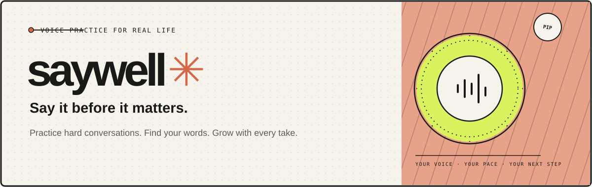

<div align="center">
  
</div>

<div align="center">

**A voice practice studio for the conversations that matter.**  
Rehearse one-on-one, bring your group together, and get specific feedback after every take.

[Run locally](#run-locally) · [Features](#features) · [How language works](#language-support)

</div>

---

## What is Saywell?

Saywell helps you build conversation skills through low-pressure voice rehearsal. Practice asking for a raise, setting a boundary, preparing for an interview, or making your own scenario. Try a different approach, then ask Saywell’s coach for an observation, one next skill to practice, and a sample line.

## Features

- **Voice rehearsals:** Talk naturally with a realistic conversation partner, interrupt, pause, or restart.
- **A group room with Pip:** Share context in a live room, mention `@pip` anywhere, and get a concise answer for everyone.
- **Conversation language control:** Choose Auto to follow the detected speaker language or select English, Spanish, French, German, Italian, or Portuguese. The choice applies during the conversation and is remembered on this device.
- **Practice reflection:** After at least two of your turns, request specific feedback on what worked and what to try next.
- **Private server credentials:** Provider keys stay in `.env`; the browser receives short-lived AssemblyAI tokens only.
- **AssemblyAI speech throughout:** Realtime speech recognition and every spoken reply use AssemblyAI, with `assemblyai-tts-1` for generated speech.

## Language support

AssemblyAI Universal-3.6 Pro Realtime detects and transcribes 32 languages, including Hindi. In Auto mode, Saywell asks the conversation model to reply in the detected language. **AssemblyAI-TTS-1 currently speaks English, Spanish, French, German, Italian, and Portuguese.** If Auto detects a language outside those six, Saywell can show the AI reply as text but cannot speak it with TTS-1. Choose one of the six supported languages to hear spoken replies. [AssemblyAI realtime language list](https://www.assemblyai.com/blog/universal-3-6-pro-realtime-supported-languages) · [AssemblyAI-TTS-1 languages](https://www.assemblyai.com/explore/text-to-speech)

## Run locally

**Requirements:** Node.js 20.19 or newer.

1. Install dependencies:

   ```bash
   npm install
   ```

2. Add credentials to the root `.env` file. The app never asks for keys in the browser.

   ```env
   ASSEMBLYAI_API_KEY=your_assemblyai_key
   OPENROUTER_API_KEY=your_openrouter_key
   OPENROUTER_MODEL=openai/gpt-4o-mini
   PIP_VOICE=aai-sara
   PORT=3001
   ```

   AssemblyAI powers realtime transcription and TTS-1 voice output. OpenRouter powers the conversation partner, group helper, and coach. Provider keys stay server-side.

3. Start the frontend and API server:

   ```bash
   npm run dev
   ```

4. Open [http://localhost:5173](http://localhost:5173).

Choose **Start a rehearsal** for a private practice, or **Bring everyone in** to create a shared room. In a group, mention `@pip` or choose **Ask Pip** to get help.

## How it works

- AssemblyAI Universal-3.6 Pro Realtime streams microphone audio and detects the language on each completed turn.
- OpenRouter generates the other person’s response in your selected language, or follows the detected language in Auto mode.
- AssemblyAI-TTS-1 streams replies in the selected language. Voice and language are selected for each turn so you can switch mid-conversation.
- The coach reviews the rehearsal and gives one strength, one practical adjustment, and a sample sentence.
- The group room syncs participant presence and chat over the app WebSocket. Pip answers in the language selected by the person who asked.
- The server mints short-lived AssemblyAI tokens. Keep provider credentials in `.env`, which is gitignored.

## Project structure

```text
src/App.tsx                Saywell landing page, rehearsal studio, language control, and group room
src/styles.css             Responsive landing page and studio styling
src/group.css              Responsive shared room UI
server.js                  Private API routes, speech tokens, AI coach, and group WebSocket
public/pcm-worklet.js      Microphone resampling for Realtime STT
public/favicon.svg         Saywell browser icon
assets/saywell-banner.svg README banner
```

## Production build

```bash
npm run build
npm start
```

Set the environment variables in your host’s secret manager and serve over HTTPS for microphone access. Add authentication and rate limits before exposing `/api/tokens`, `/api/respond`, and `/api/coach` publicly.
